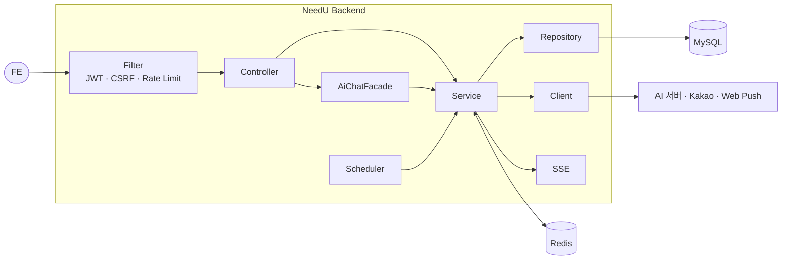
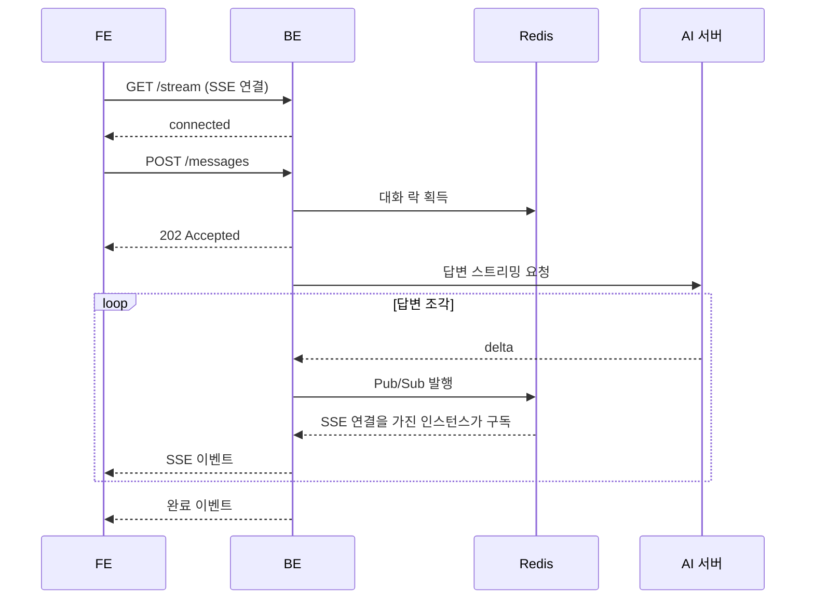
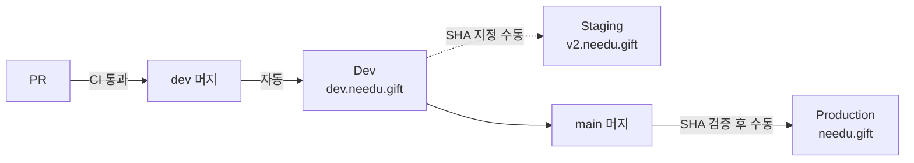

<!-- COMMON:START -->
<div align="center">

<br>

<h1>
  
  NeedU
</h1>

<h3>대화 몇 마디로 알아내는<br>나와 친구의 진짜 니즈</h3>

<p>
  <sub>AI 취향 분석&nbsp;&nbsp;·&nbsp;&nbsp;맞춤 상품 추천&nbsp;&nbsp;·&nbsp;&nbsp;친구 선물 추천&nbsp;&nbsp;·&nbsp;&nbsp;익명 채팅</sub>
</p>

<br>

<a href="https://needu.gift"></a>
&nbsp;
<a href="https://github.com/100-hours-a-week/KTB4-4th-wiki"></a>

<br>

</div>

## 서비스 소개

<p align="center">
  <sub><b>WHY NEEDU</b></sub>
</p>

<h3 align="center">
  내가 무엇을 좋아하는지,<br>
  친구가 무엇을 원하는지 모를 때
</h3>

<p align="center">
  NeedU는 AI와 나누는 짧은 대화에서 <b>나도 몰랐던 취향과 관심사</b>를 발견하고,<br>
  그 취향에 꼭 맞는 <b>나를 위한 상품</b>과 <b>친구를 위한 선물</b>을 찾아 줍니다.
</p>

<p align="center">
  <sub>취향을 말로 설명하기 어려운 사람도, 선물 앞에서 막막한 사람도 대화 몇 마디면 충분합니다.</sub>
</p>

<br>

<div align="center">
<table>
  <tr>
    <td align="center" width="180"><kbd>01</kbd><br><br><b>AI 취향 대화</b><br><sub>몰랐던 내 취향을<br>대화로 발견해요</sub></td>
    <td align="center" width="180"><kbd>02</kbd><br><br><b>맞춤 상품 추천</b><br><sub>내 취향에 맞는<br>상품만 골라요</sub></td>
    <td align="center" width="180"><kbd>03</kbd><br><br><b>친구 선물 추천</b><br><sub>친구 취향으로<br>선물을 찾아요</sub></td>
    <td align="center" width="180"><kbd>04</kbd><br><br><b>익명 채팅</b><br><sub>정체를 숨기고<br>슬쩍 물어봐요</sub></td>
    <td align="center" width="180"><kbd>05</kbd><br><br><b>알림</b><br><sub>생일·콕 찌르기를<br>놓치지 않아요</sub></td>
  </tr>
</table>
</div>

<details>
<summary><b>기능 자세히 보기</b></summary>
<br>
<div align="center">

| 기능 | 설명 |
| :---: | :---: |
| **AI 취향 대화** | AI와 편하게 이야기하면 답변이 실시간으로 이어지고,<br>대화가 끝나면 분석 결과를 확인하고 직접 다듬을 수 있습니다. |
| **맞춤 상품 추천** | 확정한 취향을 바탕으로 상품을 추천합니다.<br>가격과 카테고리로 원하는 상품만 골라 볼 수 있습니다. |
| **친구 선물 추천** | NeedU에 가입한 카카오 친구의 취향 요약을 보고,<br>그 친구에게 어울리는 선물을 추천받습니다. |
| **익명 채팅** | 친구에게 직접 묻기 어려울 때, 정체를 숨긴 채<br>대화하며 원하는 선물을 자연스럽게 물어봅니다. |
| **알림** | 친구의 생일, 친구 가입, 콕 찌르기, 구매 확인 소식을<br>앱 알림과 웹 푸시로 받습니다. |

</div>
</details>

### 팀 · 저장소

<div align="center">
<table>
  <tr>
    <th width="200">BE</th>
    <th width="200">AI</th>
    <th width="200">FE</th>
    <th width="200">CLOUD</th>
  </tr>
  <tr>
    <td align="center"><a href="https://github.com/jynoh00"></a> <a href="https://github.com/FinnPing1741"></a><br><sub><a href="https://github.com/jynoh00">jynoh00</a> · <a href="https://github.com/FinnPing1741">FinnPing1741</a></sub></td>
    <td align="center"><a href="https://github.com/seoddhh"></a><br><sub><a href="https://github.com/seoddhh">seoddhh</a></sub></td>
    <td align="center"><a href="https://github.com/juiuj"></a><br><sub><a href="https://github.com/juiuj">juiuj</a></sub></td>
    <td align="center"><a href="https://github.com/sodam2z"></a> <a href="https://github.com/hyo-lin"></a><br><sub><a href="https://github.com/sodam2z">sodam2z</a> · <a href="https://github.com/hyo-lin">hyo-lin</a></sub></td>
  </tr>
  <tr>
    <td align="center">비즈니스 로직 · API</td>
    <td align="center">대화 · 취향 분석 · 추천</td>
    <td align="center">화면 · 클라이언트 상태</td>
    <td align="center">인프라 · 배포 · 관측성</td>
  </tr>
  <tr>
    <td align="center"><a href="https://github.com/100-hours-a-week/KTB4-4th-BE"><code>KTB4-4th-BE</code></a></td>
    <td align="center"><a href="https://github.com/100-hours-a-week/KTB4-4th-AI"><code>KTB4-4th-AI</code></a></td>
    <td align="center"><a href="https://github.com/100-hours-a-week/KTB4-4th-FE"><code>KTB4-4th-FE</code></a></td>
    <td align="center"><a href="https://github.com/100-hours-a-week/KTB4-4th-CLOUD"><code>KTB4-4th-CLOUD</code></a></td>
  </tr>
</table>
</div>

<!-- COMMON:END -->

<br/>

---

<!-- PART:START -->

<div align="center">

<h1>NeedU Backend</h1>

<p>인증, 사용자·친구·상품, AI 대화 중계, 알림을 담당하는 Spring Boot 서버</p>

[](https://github.com/100-hours-a-week/KTB4-4th-BE/actions/workflows/backend-ci.yml)
[](https://github.com/100-hours-a-week/KTB4-4th-BE/actions/workflows/api-docs.yml)


</div>

<br/>

## 책임 범위

**담당**

- 카카오 로그인, JWT 쿠키 인증, CSRF, 요청 횟수 제한
- 온보딩·약관 동의, 친구(카카오 동기화·즐겨찾기·콕 찌르기), 상품 추천 조회·만족도·구매 확인
- AI 대화방 상태 관리, AI 서버 호출, 답변 SSE 중계, 분석 확정 후 추천 저장
- 알림 생성·조회, 알림 SSE, 웹 푸시, 생일·구매 확인 스케줄러
- OpenAPI 명세 생성, 이미지 빌드, ECS 배포 워크플로

**비담당**

- 화면, 클라이언트 상태, 인증 쿠키를 전달하는 동일 출처 프록시 → [FE](https://github.com/100-hours-a-week/KTB4-4th-FE)
- AI 답변 생성, 취향 분석, 추천 상품 선정 → [AI](https://github.com/100-hours-a-week/KTB4-4th-AI)
- VPC·ALB·ECS·RDS·ElastiCache 구성 → [CLOUD](https://github.com/100-hours-a-week/KTB4-4th-CLOUD)

## 기술 스택

| 분류 | 기술 | 사용 목적 |
| --- | --- | --- |
| Language | Java 25 | DTO는 `record`로 작성 |
| Framework | Spring Boot 4.1 (MVC) | REST API, `SseEmitter` 기반 SSE |
| Security | Spring Security, OAuth2 Client | 카카오 로그인, JWT 쿠키 인증, CSRF |
| Database | MySQL 8.4, Spring Data JPA | 도메인 데이터 저장 |
| Redis | Redis 7, `StringRedisTemplate` | 분산 락, 요청 횟수 제한, 인스턴스 간 이벤트 전달 |
| Cache | Caffeine | 상품 가격 범위 캐시 |
| Scheduler | ShedLock 7.10 | 여러 인스턴스에서 스케줄러 중복 실행 방지 |
| Client | `RestClient`, zerodep-web-push | AI 서버·카카오 호출, 웹 푸시 발송 |
| Docs | springdoc-openapi 3.1 | OpenAPI JSON 생성 |
| Monitoring | Sentry, Micrometer, Actuator | 오류 수집, CloudWatch 지표, 헬스 체크 |
| Test | JUnit 5, H2, MySQL | 단위 테스트는 H2, 통합 테스트는 MySQL |
| Deploy | Docker, AWS ECR·ECS, GitHub Actions | 이미지 빌드와 환경별 배포 |

## 아키텍처



**설계 원칙**

- **단방향 계층** — `Controller → Service → Repository`. 다른 도메인은 Repository가 아니라 Service로 접근하고, 여러 Service를 엮는 AI 대화 흐름만 `AiChatFacade`에 둡니다.
- **다중 인스턴스 전제** — 락·요청 제한·SSE 이벤트는 Redis, 스케줄러는 ShedLock으로 처리합니다.
- **외부 장애 격리** — AI 호출에 시간 제한을 두고, 인스턴스당 동시 답변 수를 넘으면 503으로 거절합니다.
- **민감정보 비노출** — 토큰과 AI 대화 원문은 로그에 남기지 않고, 리프레시 토큰은 해시로, 카카오 토큰은 암호화해 저장합니다.

### AI 대화 메시지 흐름



## 시작하기

**필요 도구** — JDK 25 · Docker · MySQL 8.4 · 카카오디벨로퍼스 앱

```bash
git clone https://github.com/100-hours-a-week/KTB4-4th-BE.git
cd KTB4-4th-BE

cp .env.example .env     # 값 채우기
docker compose up -d     # Redis
./gradlew bootRun
```

MySQL에는 `needu` 데이터베이스만 만들어 두면 됩니다. 테이블은 시작할 때 `db/schema.sql`과 JPA가 생성합니다.

```sql
CREATE DATABASE needu CHARACTER SET utf8mb4 COLLATE utf8mb4_unicode_ci;
```

`http://localhost:8080/actuator/health`가 `{"status":"UP"}`이면 준비 완료입니다.

> AI 서버 없이 FE와 붙여 볼 때는 `.env`에 `AI_SERVER_MOCK_ENABLED=true`를 넣으세요. 목 답변과 목 상품 데이터를 사용합니다.

<details>
<summary><b>환경 변수 목록</b></summary>

<br/>

전체 목록은 [`.env.example`](./.env.example)에 있습니다. 실제 키는 README와 `.env.example`에 넣지 않습니다.

| 변수 | 필수 | 설명 |
| --- | :---: | --- |
| `DB_USERNAME` `DB_PASSWORD` | ✓ | MySQL 계정 |
| `SPRING_DATA_REDIS_HOST` `SPRING_DATA_REDIS_PORT` | | Redis 주소 (기본 `localhost:6379`) |
| `KAKAO_REST_API_KEY` `KAKAO_CLIENT_SECRET` | ✓ | 카카오 앱 키 |
| `KAKAO_REDIRECT_URI` | ✓ | 로그인 콜백. **FE 주소**로 등록 (`http://localhost:3000/api/v1/auth/kakao/callback`) |
| `KAKAO_FRIEND_REDIRECT_URI` | ✓ | 친구 목록 동의 콜백 |
| `KAKAO_ADMIN_KEY` | ✓ | 카카오 Admin 키 |
| `KAKAO_TOKEN_ENCRYPTION_KEY` | ✓ | `openssl rand -base64 32`로 생성 |
| `JWT_SECRET` | ✓ | `openssl rand -base64 32`로 생성 |
| `AUTH_COOKIE_SECURE` | | 로컬 HTTP에서만 `false` (기본 `true`) |
| `AI_SERVER_BASE_URL` `AI_SERVICE_TOKEN` | ✓ | AI 서버 주소와 호출 토큰 |
| `AI_SERVER_MOCK_ENABLED` | | AI 서버 대신 목 응답 사용 |
| `WEB_PUSH_ENABLED` `VAPID_*` | | 웹 푸시 사용 여부와 VAPID 키 |
| `SENTRY_DSN` | | 값이 있을 때만 Sentry 활성화 |
| `CLOUDWATCH_METRICS_ENABLED` | | 운영에서만 `true` |
| `API_DOCS_ENABLED` | | `/v3/api-docs` 노출 (기본 `false`) |

</details>

## API

- 모든 경로는 `/api/v1`로 시작하고, 응답은 `{ "message", "data" }` 형식입니다. 오류도 같은 형식입니다.
- 명세는 `dev` 브랜치 기준으로 자동 생성됩니다 → **[Swagger UI]({{API_DOCS_URL}})**

| 구분 | 방식 |
| --- | --- |
| 인증 | `HttpOnly` 쿠키로 액세스(15분)·리프레시(14일) 토큰 전달 |
| CSRF | 상태 변경 요청에 `GET /auth/csrf`로 받은 토큰을 `X-XSRF-TOKEN` 헤더로 전송 |
| AI 대화 SSE | `GET /ai/conversations/{id}/stream` — 25초 heartbeat, 30분 후 재연결 |
| 알림 SSE | `GET /notifications/stream` |
| BE → AI | `/v1/chat/sessions` 계열 REST·스트리밍 API → [AI 저장소](https://github.com/100-hours-a-week/KTB4-4th-AI) |

## 디렉터리 구조

```text
src/main/java/kr/ktb/zura/needu
├── common          보안 · 예외 · 응답 형식 · 요청 제한 · Redis · OpenAPI
├── auth            카카오 로그인, 토큰 · 세션, CSRF
├── user            내 정보, 온보딩, 약관 동의, 탈퇴
├── friend          카카오 친구 동기화, 친구 목록 · 상세, 콕 찌르기, 생일 알림
├── aichat          AI 대화방 · 메시지, AI 클라이언트, SSE, AiChatFacade
├── taste           취향 분석 결과
├── product         상품, 개인 · 선물 추천, 만족도, 구매 확인
├── guidance        메인 화면 안내 문구
├── notification    알림 · 알림 설정, 알림 SSE, 웹 푸시
└── feedback        오류 신고
```

각 도메인은 `controller` `dto` `service` `repository` `entity`로 나누고, 필요하면 `client` `sse`를 둡니다. 정책 값은 `business-policy.yml`, 요청 제한은 `rate-limit.yml`에 있습니다.

## 테스트

```bash
./gradlew test              # 단위 · 슬라이스 테스트 (H2)
./gradlew integrationTest   # 통합 테스트 (MySQL needu_test, test/test)
./gradlew build
```

| 종류 | 대상 |
| --- | --- |
| 단위 | Service · Facade · Client · Filter의 분기와 예외 |
| 슬라이스 | Controller 요청 검증 · 응답 형식, Repository 쿼리 |
| 통합 | `*IntegrationTest` — 인증 흐름, 친구 조회 등 MySQL 의존 경로 |

PR은 `test`·`build`를 통과해야 하고, `dev` 대상 PR은 통합 테스트와 Docker 빌드까지 CI에서 확인합니다.

## 배포



- **Dev** — `dev`에 푸시하면 이미지를 ECR에 올리고 ECS에 자동 배포합니다.
- **Staging** — 배포할 Git SHA를 넣고 워크플로를 수동 실행합니다.
- **Production** — SHA가 `main`에 포함되고 Dev에서 검증한 이미지와 같을 때만 배포되며, 끝나면 `prod-YYYYMMDD-N` 태그가 붙습니다.
- **롤백** — 이전에 검증한 SHA로 같은 워크플로를 다시 실행합니다. 이미지는 SHA 태그로 남아 있어 다시 빌드하지 않습니다.
- **모니터링** — 오류는 Sentry, DB 커넥션 지표는 CloudWatch, 헬스 체크는 `/actuator/health`

## 기술적 결정

### 추천 조회 처리량 약 19배 개선

부하 테스트에서 사용자 수를 늘려도 처리량이 초당 약 110건에서 멈췄습니다. 추적해 보니 MySQL 옵티마이저 통계가 0행으로 남아 있어 추천 쿼리가 인덱스 대신 전체 스캔을 하고 있었습니다. `ANALYZE TABLE`로 통계를 갱신했습니다.

| 지표 | 이전 | 이후 |
| --- | ---: | ---: |
| 최대 처리량 (RPS) | 약 107 | **2,091** |
| p95 응답 시간 (VU 200) | 3,742ms | **176ms** |
| 요청당 커넥션 점유 | 92ms | **1.9~4.4ms** |

<sub>로컬 Docker, 앱 2코어 · 1GB, HikariCP 10개 기준. 측정 방법은 [loadtest](./loadtest/README.md) 참고</sub>

### AI 메시지 전송을 202 + SSE로 분리

AI 답변 생성이 길어 메시지 전송 요청이 오래 붙잡혔습니다. 전송은 **202 Accepted**로 바로 응답하고, 답변은 백그라운드에서 만들어 SSE로 보냅니다. 인스턴스당 동시 답변 수(기본 200)를 넘으면 메시지를 저장하지 않고 503으로 거절해 AI 서버를 보호합니다.

### Redis Pub/Sub으로 인스턴스 간 SSE 전달

SSE 연결과 답변 생성이 서로 다른 인스턴스에서 일어날 수 있습니다. 답변 이벤트를 Redis Pub/Sub으로 모든 인스턴스에 뿌려, 어느 인스턴스에 연결돼 있어도 답변을 받습니다.

### API 문서는 CI에서 생성해 별도 배포

운영 서버의 `/v3/api-docs`는 꺼 두고, `dev` 푸시 때 CI가 OpenAPI JSON을 만들어 Cloudflare Pages에 올립니다. 문서가 코드와 항상 같은 시점을 가리킵니다.

## 협업 규칙

| 항목 | 규칙 |
| --- | --- |
| 브랜치 | `main` 운영 · `dev` 개발 통합 · `feature/{이슈번호}-{작업명}` |
| 커밋 | `feat:` `fix:` `refactor:` `test:` `chore:` `docs:` + 한글 요약 |
| PR | 1,000줄 이하, `./gradlew test` · `build` 통과, {{REQUIRED_REVIEW_COUNT}}명 이상 승인 |

## 문제 해결

<details>
<summary><code>Could not resolve placeholder 'DB_USERNAME'</code>으로 시작되지 않습니다</summary>

<br/>

`.env`가 없거나 필수 값이 비어 있습니다. 저장소 루트에서 `cp .env.example .env` 후 값을 채우세요. `.env`는 실행한 디렉터리 기준으로 읽습니다.

</details>

<details>
<summary>카카오 로그인 후 로그인 상태가 유지되지 않습니다</summary>

<br/>

`KAKAO_REDIRECT_URI`가 BE 포트(`:8080`)를 가리키면 쿠키가 FE 호스트에 설정되지 않습니다. 카카오디벨로퍼스와 `.env` 모두 FE 주소(`http://localhost:3000/api/v1/auth/kakao/callback`)로 맞추고, 로컬 HTTP라면 `AUTH_COOKIE_SECURE=false`로 둡니다.

</details>

<details>
<summary>POST · PUT · PATCH · DELETE가 403 "보안 토큰이 만료되었습니다."로 실패합니다</summary>

<br/>

CSRF 토큰이 없거나 만료됐습니다. `GET /api/v1/auth/csrf`의 `data.token`을 `X-XSRF-TOKEN` 헤더에 넣고, 같은 응답의 CSRF 쿠키도 함께 보내세요.

</details>

<details>
<summary><code>RedisConnectionFailureException</code>이 발생합니다</summary>

<br/>

`docker compose up -d`로 Redis를 띄우고 `docker compose ps`에서 `healthy`인지 확인하세요.

</details>

<details>
<summary>데이터를 대량으로 넣은 뒤 추천 조회가 느려졌습니다</summary>

<br/>

옵티마이저 통계가 갱신되지 않아 인덱스를 쓰지 않는 경우입니다.

```sql
ANALYZE TABLE users, friends, products, personal_recommendations, gift_recommendations;
```

</details>

## 문서 · 문의

- [Swagger UI]({{API_DOCS_URL}}) · [팀 위키](https://github.com/100-hours-a-week/KTB4-4th-wiki) · [부하 테스트](./loadtest/README.md)
- 이슈: [GitHub Issues](https://github.com/100-hours-a-week/KTB4-4th-BE/issues) · 팀 채널: {{TEAM_CHANNEL}}
- 라이선스: 아직 정하지 않았습니다.

<!-- PART:END -->
